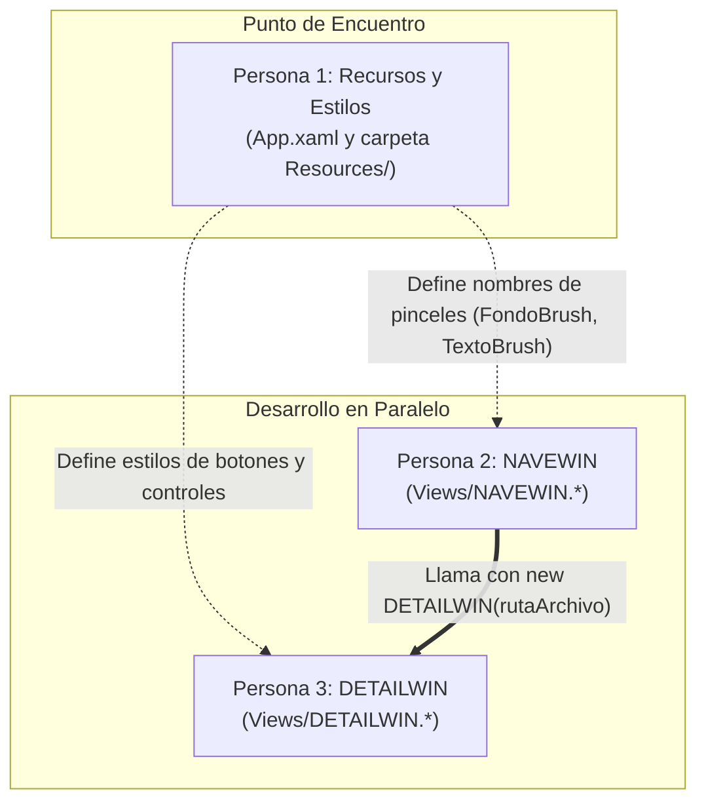
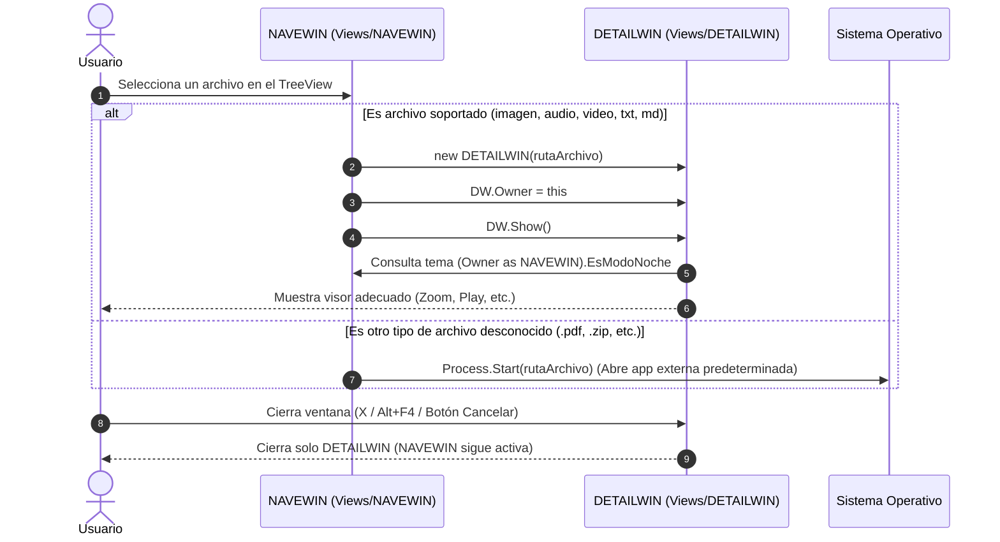

# VIS02 - Galería Multimedia y Visor de Archivos (WPF)

Este repositorio contiene la solución en WPF (.NET) para la práctica **VIS02**.

---

## 📁 Estructura del Proyecto (Arquitectura Estándar)

El proyecto sigue una organización limpia por responsabilidades (patrón estándar en desarrollo .NET/WPF), separando las vistas de interfaz, los recursos de diseño y la configuración general:

```text
VIS02/
├── .gitignore                      # Exclusiones de Git (bin, obj, .vs, pdfs, temporales)
├── enunciado.md                    # Requisitos detallados y especificaciones de la práctica
├── README.md                       # Documentación de arquitectura, reparto y tareas
├── WpfApp1.slnx                    # Archivo de solución de Visual Studio
└── WpfApp1/                        # Proyecto WPF
    ├── WpfApp1.csproj              # Configuración del proyecto (.NET 10 WPF)
    ├── App.xaml                    # Recursos globales (Colores Modo Normal / Modo Noche)
    ├── App.xaml.cs                 # Lógica del ciclo de vida de la aplicación
    │
    ├── Views/                      # Carpeta de Vistas / Ventanas (Interfaces de usuario)
    │   ├── NAVEWIN.xaml            # Ventana Principal (Explorador TreeView, Selección de carpeta)
    │   ├── NAVEWIN.xaml.cs         # Lógica de navegación y llamada a DETAILWIN
    │   ├── DETAILWIN.xaml          # Ventana de Detalle (Visores según tipo de archivo)
    │   └── DETAILWIN.xaml.cs       # Lógica de carga dinámica, zoom, reproducción y cierre
    │
    └── Resources/                  # Diccionarios de Recursos independientes (XAML)
        ├── ImageStyles.xaml        # Estilos para visor de imágenes y controles de Zoom
        ├── MediaStyles.xaml        # Estilos para reproductor multimedia (Play/Pause)
        ├── TextStyles.xaml         # Estilos para visualización de texto (Font y FontSize)
        └── MarkdownStyles.xaml     # Estilos para visor Markdown (.md)
```

---

## 👥 Reparto de Tareas y Flujo de Trabajo en Paralelo (3 Personas)

Las tareas se han diseñado para ser **100% independientes**, permitiendo que cada miembro trabaje en su propia rama sin generar bloqueos ni conflictos en Git:



### El "Contrato de Integración" entre los 3
Para trabajar de forma autónoma sin depender de que el otro haya terminado:
1. **Persona de Estilos y Temas**: Define en `App.xaml` los recursos dinámicos (`DynamicResource FondoBrush`, `DynamicResource TextoBrush`). Las otras dos personas simplemente usan esas claves en el `Background` y `Foreground` de sus vistas.
2. **Persona de NAVEWIN**: Puede probar su explorador `TreeView` de carpetas abriendo la ventana con `new DETAILWIN(ruta).Show()` o con un `MessageBox.Show(ruta)` sin necesidad de que los visores estén acabados.
3. **Persona de DETAILWIN**: Puede probar sus visores (zoom de imágenes, audio/vídeo, texto y markdown) cambiando temporalmente `StartupUri="Views/DETAILWIN.xaml"` en `App.xaml` o pasándole una ruta fija en su constructor para probarla con <kbd>F5</kbd>.

---

## 🔄 ¿Cómo se comunican las ventanas entre sí?



---

## 📋 Lista Completa de Tareas Pendientes por Módulo

### Módulo 1: Sistema de Estilos y Temas (`App.xaml` y `Resources/`)
- [ ] **Definición de Colores en `App.xaml`**:
  - Pinceles (`SolidColorBrush`) para **Modo Normal**: `FondoBrush` (claro) y `TextoBrush` (oscuro).
  - Pinceles para **Modo Noche**: `FondoBrush` (oscuro) y `TextoBrush` (claro).
  - Estilos base para `Grid`, `TextBox` y `Label` vinculados a estos recursos dinámicos.
- [ ] **Lógica de Conmutación de Tema**:
  - Mecanismo en C# para alternar entre el diccionario/paleta Normal y Noche en tiempo de ejecución.
- [ ] **Estilos en `Window.Resources`**:
  - Estilos de botones diferenciados en `NAVEWIN.xaml` (bordes, fuentes, padding).
  - Estilos de botones diferenciados en `DETAILWIN.xaml`.
- [ ] **Completar Diccionarios de Recursos (`Resources/`)**:
  - `ImageStyles.xaml`: Estilos para botones de Zoom In / Zoom Out.
  - `MediaStyles.xaml`: Estilos para controles multimedia (Play, Pause, etc.).
  - `TextStyles.xaml`: Estilos para fuentes y controles de tamaño.
  - `MarkdownStyles.xaml`: Estilos específicos para la presentación Markdown.

---

### Módulo 2: Ventana Principal (`Views/NAVEWIN.*`)
- [ ] **Explorador con `TreeView`**:
  - Sustituir el `OpenFileDialog` por un control `TreeView` integrado en la ventana.
  - Al iniciar la app, cargar automáticamente la carpeta del sistema **"Mis imágenes"** (`Environment.GetFolderPath(Environment.SpecialFolder.MyPictures)`).
  - Mostrar carpetas y archivos con nombres e iconos representativos.
  - Permitir desplegar y navegar por subcarpetas.
- [ ] **Diálogo de Selección de Carpeta**:
  - Botón para abrir diálogo de selección de carpeta (`FolderBrowserDialog` o `OpenFolderDialog`) para cambiar el directorio raíz explorado.
- [ ] **Selector de Modo Noche**:
  - Control (Toggle / CheckBox / Botón) en la interfaz para alternar entre Modo Normal y Modo Noche.
- [ ] **Apertura de archivos al hacer clic**:
  - Doble clic o selección de un archivo que abra la ventana `DETAILWIN` pasándole la ruta seleccionada (`new DETAILWIN(ruta).Show()`).

---

### Módulo 3: Ventana de Detalle (`Views/DETAILWIN.*`)
- [ ] **Visor de Imágenes**:
  - Componente `<Image>` nativo dentro de `DETAILWIN` (no visor externo).
  - Botones funcionales para **Zoom In** y **Zoom Out** (mediante `ScaleTransform` o ajuste de dimensiones).
- [ ] **Visor Multimedia (Audio / Vídeo)**:
  - Componente `<MediaElement>` para reproducir `.mp3`, `.mp4`, `.wav`, etc.
  - Botones funcionales de control: **Play** y **Pause**.
- [ ] **Visor de Texto Plano (.txt)**:
  - Trasladar el visor de texto a `DETAILWIN`.
  - Botones funcionales para cambiar la **Fuente (Font)** y aumentar/disminuir el tamaño de letra (**FontSize +/-**).
- [ ] **Visor Markdown (.md)**:
  - Añadir paquete NuGet Markdown (p. ej. `WPF-UI.Markdown`).
  - Integrar el control del visor Markdown para renderizar archivos `.md`.
- [ ] **Apertura de Otros Archivos**:
  - Para extensiones no contempladas directamente, lanzar la aplicación asociada con `Process.Start`.
- [ ] **Gestión de Cierre y Sincronización**:
  - Botón "Cancelar" con propiedad `IsCancel="True"` que cierre la ventana.
  - Capturar evento `Closing` para asegurar que cerrar con <kbd>Alt</kbd> + <kbd>F4</kbd> o la `X` **no** cierre la aplicación completa, sino solo `DETAILWIN`.
  - Consultar el tema (`EsModoNoche`) de su ventana `Owner` (`NAVEWIN`) para heredar los colores.
