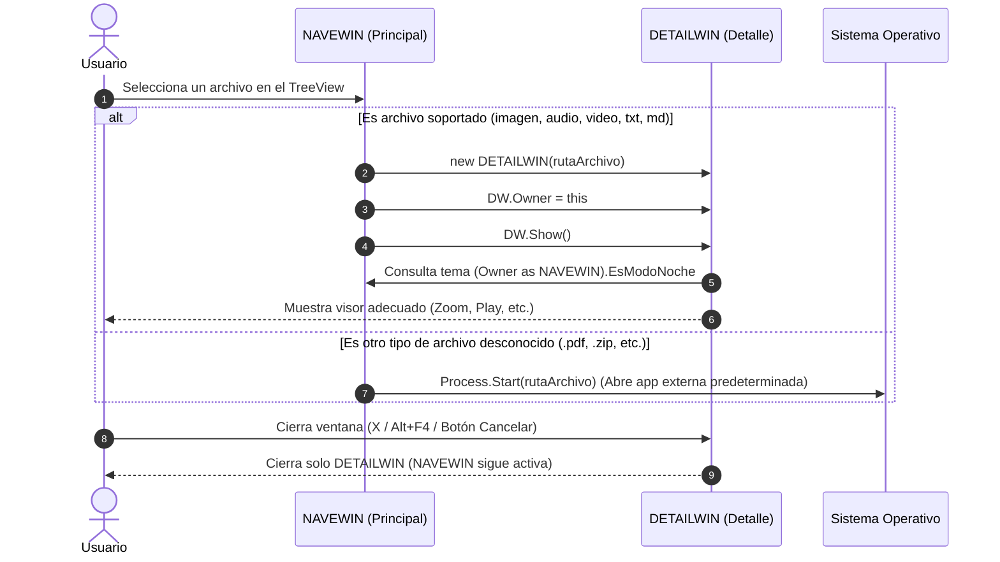

# VIS02 - Galería Multimedia y Visor de Archivos (WPF)

Este repositorio contiene la solución en WPF (.NET) para la práctica **VIS02**.

---

## 📁 Estructura del Proyecto

A continuación se muestra el mapa completo de archivos y carpetas del proyecto:

```text
VIS02/
├── .gitignore                  # Exclusiones de Git (bin, obj, .vs, pdfs, temporales)
├── enunciado.md                # Requisitos detallados y especificaciones de la práctica
├── README.md                   # Documentación de arquitectura, archivos y comunicación
├── WpfApp1.slnx                # Archivo de solución de Visual Studio
└── WpfApp1/                    # Proyecto WPF
    ├── WpfApp1.csproj          # Configuración del proyecto (.NET 10 WPF)
    ├── App.xaml                # Recursos globales a nivel de aplicación (Colores Normal/Noche)
    ├── App.xaml.cs             # Lógica del ciclo de vida de la aplicación
    │
    ├── NAVEWIN.xaml            # Ventana Principal (Explorador, TreeView, Selección carpeta)
    ├── NAVEWIN.xaml.cs         # Lógica de navegación y llamada a DETAILWIN
    │
    ├── DETAILWIN.xaml          # Ventana de Detalle (Visores según tipo de archivo)
    ├── DETAILWIN.xaml.cs       # Lógica de carga dinámica, zoom, reproducción y cierre
    │
    ├── Resources/              # Diccionarios de Recursos independientes (XAML)
    │   ├── ImageStyles.xaml    # Estilos para visor de imágenes y controles de Zoom
    │   ├── MediaStyles.xaml    # Estilos para reproductor multimedia (Play/Pause)
    │   ├── TextStyles.xaml     # Estilos para visualización de texto (Font y FontSize)
    │   └── MarkdownStyles.xaml # Estilos para visor Markdown (.md)
    │
    ├── MainWindow.xaml         # (Código heredado / pruebas de inicio de Guille)
    ├── MainWindow.xaml.cs      # (Código heredado / pruebas de inicio de Guille)
    ├── Window1.xaml            # (Código heredado / pruebas de inicio de Guille)
    └── Window1.xaml.cs         # (Código heredado / pruebas de inicio de Guille)
```

---

## 🧩 ¿Qué hace cada archivo y cómo se estructuran?

### 1. `App.xaml` (Recursos Globales de la Aplicación)
- **Propósito:** Alojar los colores de la aplicación para el **Modo Normal** (fondo claro, letra oscura) y **Modo Noche** (fondo oscuro, letra clara) aplicables a `Grid`, `TextBox` y `Label`.
- **Ventaja:** Cualquier ventana puede referenciar estos pinceles (`DynamicResource`) para cambiar de color al unísono.

### 2. `NAVEWIN` (Ventana Principal de Navegación)
- **`NAVEWIN.xaml`:** Contiene la interfaz de navegación (un control `TreeView` para explorar carpetas/archivos, botón para elegir carpeta y selector de Modo Normal/Noche). En su `Window.Resources` define los estilos propios para sus botones.
- **`NAVEWIN.xaml.cs`:** 
  1. Al arrancar, obtiene la ruta de la carpeta *"Mis imágenes"* del sistema (`Environment.SpecialFolder.MyPictures`) y la carga en el `TreeView`.
  2. Si el usuario pulsa en seleccionar carpeta, muestra el diálogo para cambiar el directorio raíz.
  3. Al seleccionar un archivo que **no** sea carpeta, instancia y abre `DETAILWIN` pasándole la ruta del archivo.
  4. Expone su estado de tema (`EsModoNoche`) para que `DETAILWIN` lo consulte.

### 3. `DETAILWIN` (Ventana de Detalle)
- **`DETAILWIN.xaml`:** Contiene los diferentes contenedores/controles para mostrar el contenido según el tipo de archivo (`Image`, `MediaElement`, `TextBox`, visor `Markdown`) y los botones de acción (`Zoom`, `Play/Pause`, `Font`, botón `Cancelar` con `IsCancel="True"`).
- **`DETAILWIN.xaml.cs`:**
  1. Recibe la ruta del archivo en su constructor (`new DETAILWIN(rutaArchivo)`).
  2. Detecta la extensión del archivo y activa el visor correspondiente.
  3. Consulta a su ventana padre (`Owner as NAVEWIN`) para heredar el tema (Normal/Noche).
  4. Gestiona el evento de cierre (`Closing`) para que al pulsar `X` o <kbd>Alt</kbd> + <kbd>F4</kbd> solo se cierre esta ventana y nunca la aplicación completa.

### 4. `Resources/` (Diccionarios de Recursos Modulares)
Archivos XAML independientes que se importan en `DETAILWIN` para cumplir el requisito de diccionarios de recursos:
- **`ImageStyles.xaml`:** Estilos para la imagen y botones de Zoom.
- **`MediaStyles.xaml`:** Estilos para controles multimedia (Play, Pause, Stop).
- **`TextStyles.xaml`:** Estilos para el cuadro de texto y selectores de fuente.
- **`MarkdownStyles.xaml`:** Estilos visuales del visor Markdown.

---

## 🔄 ¿Cómo se comunican las ventanas entre sí?


