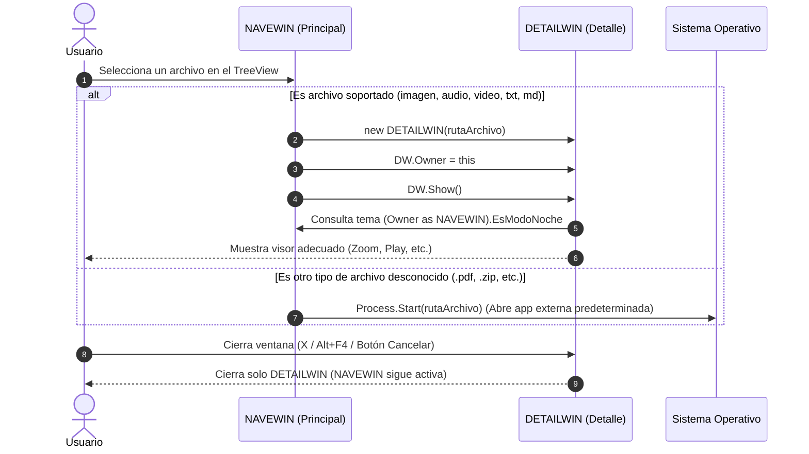

# VIS02 - Galería Multimedia y Visor de Archivos (WPF)

Este repositorio contiene la solución en WPF (.NET) para la práctica **VIS02**.

---

## 📁 Estructura del Proyecto

A continuación se muestra el mapa completo de archivos y carpetas del proyecto:

```text
VIS02/
├── .gitignore                  # Exclusiones de Git (bin, obj, .vs, pdfs, temporales)
├── enunciado.md                # Requisitos detallados y especificaciones de la práctica
├── README.md                   # Documentación de arquitectura, archivos y tareas pendientes
├── WpfApp1.slnx                # Archivo de solución de Visual Studio
└── WpfApp1/                    # Proyecto WPF
    ├── WpfApp1.csproj          # Configuración del proyecto (.NET 10 WPF)
    ├── App.xaml                # Recursos globales a nivel de aplicación (Colores Normal/Noche)
    ├── App.xaml.cs             # Lógica del ciclo de vida de la aplicación
    │
    ├── NAVEWIN.xaml            # Ventana Principal (Explorador, TreeView, Selección carpeta)
    ├── NAVEWIN.xaml.cs         # Lógica de navegación y llamada a DETAILWIN
    │
    ├── DETAILWIN.xaml          # Ventana de Detalle (Visores según tipo de archivo)
    ├── DETAILWIN.xaml.cs       # Lógica de carga dinámica, zoom, reproducción y cierre
    │
    └── Resources/              # Diccionarios de Recursos independientes (XAML)
        ├── ImageStyles.xaml    # Estilos para visor de imágenes y controles de Zoom
        ├── MediaStyles.xaml    # Estilos para reproductor multimedia (Play/Pause)
        ├── TextStyles.xaml     # Estilos para visualización de texto (Font y FontSize)
        └── MarkdownStyles.xaml # Estilos para visor Markdown (.md)
```

---

## 🧩 ¿Qué hace cada archivo y cómo se estructuran?

### 1. `App.xaml` (Recursos Globales de la Aplicación)
- **Propósito:** Alojar los colores de la aplicación para el **Modo Normal** (fondo claro, letra oscura) y **Modo Noche** (fondo oscuro, letra clara) aplicables a `Grid`, `TextBox` y `Label`.
- **Ventaja:** Cualquier ventana puede referenciar estos pinceles (`DynamicResource`) para cambiar de color al unísono.
- **Punto de Entrada:** Configurado con `StartupUri="NAVEWIN.xaml"`.

### 2. `NAVEWIN` (Ventana Principal de Navegación)
- **`NAVEWIN.xaml`:** Contiene la interfaz de navegación (un control `TreeView` para explorar carpetas/archivos, botón para elegir carpeta y selector de Modo Normal/Noche). En su `Window.Resources` define los estilos propios para sus botones.
- **`NAVEWIN.xaml.cs`:** 
  1. Al arrancar, obtiene la ruta de la carpeta *"Mis imágenes"* del sistema (`Environment.SpecialFolder.MyPictures`) y la carga en el `TreeView`.
  2. Si el usuario pulsa en seleccionar carpeta, muestra el diálogo para cambiar el directorio raíz.
  3. Al seleccionar un archivo que **no** sea carpeta, instancia y abre `DETAILWIN` pasándole la ruta del archivo.
  4. Expone su estado de tema (`EsModoNoche`) para que `DETAILWIN` lo consulte.

### 3. `DETAILWIN` (Ventana de Detalle)
- **`DETAILWIN.xaml`:** Contiene los diferentes contenedores/controles para mostrar el contenido según el tipo de archivo (`Image`, `MediaElement`, `TextBox`, visor `Markdown`) y los botones de acción (`Zoom`, `Play/Pause`, `Font`, botón `Cancelar` con `IsCancel="True"`).
- **`DETAILWIN.xaml.cs`:**
  1. Recibe la ruta del archivo en su constructor (`new DETAILWIN(rutaArchivo)`).
  2. Detecta la extensión del archivo y activa el visor correspondiente.
  3. Consulta a su ventana padre (`Owner as NAVEWIN`) para heredar el tema (Normal/Noche).
  4. Gestiona el evento de cierre (`Closing`) para que al pulsar `X` o <kbd>Alt</kbd> + <kbd>F4</kbd> solo se cierre esta ventana y nunca la aplicación completa.

### 4. `Resources/` (Diccionarios de Recursos Modulares)
Archivos XAML independientes que se importan en `DETAILWIN` para cumplir el requisito de diccionarios de recursos:
- **`ImageStyles.xaml`:** Estilos para la imagen y botones de Zoom.
- **`MediaStyles.xaml`:** Estilos para controles multimedia (Play, Pause, Stop).
- **`TextStyles.xaml`:** Estilos para el cuadro de texto y selectores de fuente.
- **`MarkdownStyles.xaml`:** Estilos visuales del visor Markdown.

---

## 🔄 ¿Cómo se comunican las ventanas entre sí?



---

## 📋 Lista Completa de Tareas Pendientes de Implementar

A continuación se detalla todo lo que falta por desarrollar respecto al enunciado oficial:

### 1. Sistema de Estilos y Temas (Requisito de Evaluación)
- [ ] **Definición de Temas en `App.xaml`**:
  - Pinceles (`SolidColorBrush`) para Modo Normal: `Background` (claro) y `Foreground` (oscuro).
  - Pinceles para Modo Noche: `Background` (oscuro) y `Foreground` (claro).
  - Estilos base para `Grid`, `TextBox` y `Label` vinculados a estos recursos dinámicos.
- [ ] **Lógica de Conmutación de Tema**:
  - Mecanismo en C# para alternar entre la paleta Normal y Noche en tiempo de ejecución.
- [ ] **Estilos en `Window.Resources`**:
  - Estilos de botones diferenciados en `NAVEWIN.xaml` (bordes, fuentes, padding).
  - Estilos de botones diferenciados en `DETAILWIN.xaml`.
- [ ] **Completar Diccionarios de Recursos (`Resources/`)**:
  - `ImageStyles.xaml`: Estilos para botones de Zoom In / Zoom Out.
  - `MediaStyles.xaml`: Estilos para botones multimedia (Play, Pause, etc.).
  - `TextStyles.xaml`: Estilos para fuentes y controles de tamaño.
  - `MarkdownStyles.xaml`: Estilos específicos para la presentación Markdown.

### 2. Ventana Principal (`NAVEWIN`)
- [ ] **Explorador con `TreeView`**:
  - Reemplazar el `OpenFileDialog` inicial por un control `TreeView` integrado en la ventana.
  - Al iniciar, cargar automáticamente la carpeta del sistema **"Mis imágenes"** (`Environment.SpecialFolder.MyPictures`).
  - Mostrar carpetas y archivos con nombres e iconos representativos.
  - Permitir desplegar y navegar por subcarpetas.
- [ ] **Diálogo de Selección de Carpeta**:
  - Botón para abrir diálogo de selección de carpeta (`FolderBrowserDialog` o `OpenFolderDialog`) para cambiar el directorio raíz explorado.
- [ ] **Selector de Modo Noche**:
  - Control (Toggle / CheckBox / Botón) en la interfaz para alternar entre Modo Normal y Modo Noche.
- [ ] **Apertura de archivos al hacer clic**:
  - Doble clic o selección de un archivo que abra la ventana `DETAILWIN` pasándole la ruta seleccionada.

### 3. Ventana de Detalle (`DETAILWIN`)
- [ ] **Visor de Imágenes**:
  - Componente `<Image>` nativo dentro de `DETAILWIN` (no visor externo).
  - Botones funcionales para **Zoom In** y **Zoom Out** (mediante `ScaleTransform` o ajuste de dimensiones).
- [ ] **Visor Multimedia (Audio / Vídeo)**:
  - Componente `<MediaElement>` para reproducir `.mp3`, `.mp4`, `.wav`, etc.
  - Botones funcionales de control: **Play** y **Pause**.
- [ ] **Visor de Texto Plano (.txt)**:
  - Trasladar el visor de texto a `DETAILWIN`.
  - Botones funcionales para cambiar la **Fuente (Font)** y aumentar/disminuir el tamaño de letra (**FontSize +/-**).
- [ ] **Visor Markdown (.md)**:
  - Añadir paquete NuGet Markdown (p. ej. `WPF-UI.Markdown`).
  - Integrar el control del visor Markdown para renderizar archivos `.md`.
- [ ] **Apertura de Otros Archivos**:
  - Para extensiones no contempladas directamente, lanzar la aplicación asociada con `Process.Start`.
- [ ] **Gestión de Cierre y Sincronización**:
  - Botón "Cancelar" con propiedad `IsCancel="True"` que cierre la ventana.
  - Capturar evento `Closing` para asegurar que cerrar con <kbd>Alt</kbd> + <kbd>F4</kbd> o la `X` **no** cierre la aplicación completa, sino solo `DETAILWIN`.
  - Consultar el tema (`EsModoNoche`) de su ventana `Owner` (`NAVEWIN`) para heredar los colores.
